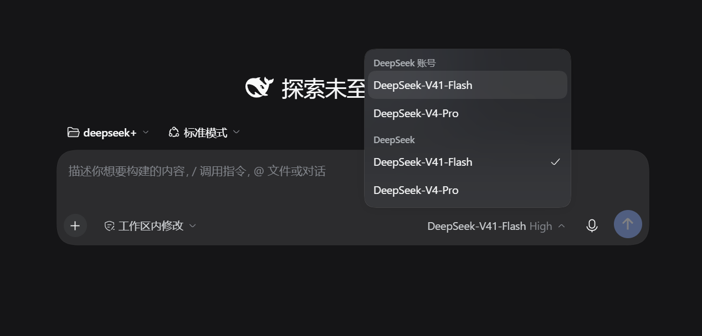

# TraeCode 任务书：输入框模型控制与 PDF 自助入库

日期：2026-10-14。项目：`D:\RAG`。执行方：**TraeCode**。状态：设计与交接已记录，功能待实施。

> 用户仍要求由 Trae 实施。本轮协调者只做复核和任务文档，不实现业务功能。按本文件顺序执行，保留现有有效改动。

**Goal：** 将模型切换与思考低/中/高移到聊天输入框右下角；输入框左下角“＋”可添加地学 PDF，用户在网页内完成抽取、切块预览、参数调整、重切块和建立索引，无需手动运行脚本。

**Architecture：** 保留现有 Streamlit 应用和双 provider。输入框控制栏复用模型目录、能力映射和持久偏好；新增独立的本地导入作业层复用修正后的分类、抽取、切块和索引服务。所有入库先写候选版本，通过质量及索引校验后激活，问答始终使用一个完整有效版本。

**Tech Stack：** 当前项目 Python/Streamlit、`model_settings.py`、`ingest.py`、`store.py`、`retrieval.py`、SiliconFlow/DeepSeek。优先使用当前安装版本的官方原生组件；必要的局部输入组件不得依赖私有 DOM 选择器或不透明前端脚本。

**Spec：** 用户最新截图和请求：“模型切换，以及中低高移到这个位置，同时可以添加 PDF，自主 chunk 这些功能”。本文件覆盖旧任务“只有进入设置才能切模型/思考”的布局要求；引用、仅地学语料、隐私、证据和联网模式约束继续有效。

## 1. 截图位置与交互规范

截图已保存到仓库文档附件，避免临时文件失效：



采用截图的位置关系，保留项目当前简洁中文风格；不把截图里的模型 ID、账号、品牌或深色主题当作项目必须采用的配置。

```text
┌────────────────────────────────────────────────────────────────────┐
│ 已添加文件：论文 A.pdf · 待处理                  [查看处理进度]       │
│                                                                    │
│ 在这里输入地学问题……                                               │
│                                                                    │
│ [＋]                         [当前模型 ▾] [思考：中 ▾] [发送 ↑]       │
└────────────────────────────────────────────────────────────────────┘
```

- 模型与思考控件处于**输入框同一容器底部右侧、发送按钮左侧**，不是移到页面顶部或另一个设置栏。文件入口在同一底栏左侧。
- 点击模型名称弹出可选模型菜单；选择后勾选状态与底栏标签同步。菜单向上/自适应展开，不能被输入框或窗口底边裁切。
- 思考菜单提供“关闭、低、中、高”中该模型实际支持的选项；固定开启、仅两档、仅开关或未知能力不能伪装成完整三档。
- 桌面保持底栏右对齐；窄屏允许底栏换行但不覆盖文本、发送按钮或文件入口。键盘能聚焦、选择、关闭菜单，控件有中文无障碍名称。
- “设置”保留高级检索、provider、目录刷新等低频操作；模型/思考的高频选择迁移到底栏，不保留两套会不同步的保存流程。

## 2. 接手顺序与已有缺陷

先读 `AGENTS.md`、`docs/PROJECT_BRIEF.md`、`docs/EXECUTION_PLAN.md`、`docs/agents/TraeCode接手任务.md`、`docs/agents/TraeCode模型选择与思考设置.md` 和 [独立复核与返工](../../agents/TraeCode交付独立复核与返工_2026-10-14.md)。

先修引用元数据/一致性和索引失败门槛。当前新库的有效向量已齐全，可以作为保留版本；不要为新 UI 无条件重跑全部 PDF/嵌入。

## 3. 实施 A：输入框模型与思考控制栏

**修改：** `src/geochem_rag/app.py`、必要时 `model_settings.py`；复杂布局可抽到 `src/geochem_rag/chat_composer.py`。**测试：** `tests/test_app.py`、`tests/test_model_settings.py`、`tests/test_model_catalog.py`，新增 `tests/test_chat_composer.py`。

- [ ] 先核实当前 Streamlit 版本的输入组件、容器及菜单能力。优先原生控件组合成一个完整输入区域；不能只是 CSS 绝对定位几个漂浮按钮，导致滚动/缩放/键盘不可用。
- [ ] 复用已有实际模型目录和缓存，不写死截图中的模型，不在每次 rerun 或切思考时重复请求 `/models`。
- [ ] 选择模型/思考后经能力校验立即应用于**下一条新提问**，底栏明确显示当前值；不要求再进入设置点击保存，不自动发送尚未提交的问题。
- [ ] 输入草稿、已选附件、聊天历史在选模型、切档、打开菜单和刷新目录时保留，不触发 RAG 回答、全量索引或额外聊天请求。
- [ ] 已发送的问题冻结其请求配置，回答记录实际模型与思考参数。进行中的请求不因控件变化被偷偷换模型；可暂禁用相关控件或明确注明变更仅影响下一次发送。
- [ ] 档位映射沿用已验证的能力契约，必要时按实际官方信息更新。只在菜单内需要解释差异时提供简短说明，不在输入框堆满 API 字段。
- [ ] 切到能力不同的模型时，选择合法的已保存偏好或明确提示调整；保存失败/能力校验失败不能让界面显示新值而后端仍用旧值。
- [ ] 偏好仍保存到既有本地设置文件；不新增密钥输入/持久化方案，不因更换对话模型改变嵌入模型或重建向量。

**验收：** 连续输入草稿 → 换模型 → 低/中/高切换 → 发问，捕获脱敏实际请求确认下一次调用的 model 与合法思考值；刷新页面后偏好保留，历史回答仍显示当时的模型。

## 4. 实施 B：左下角“＋”添加 PDF

**修改：** `app.py`/`chat_composer.py`；建议新增 `src/geochem_rag/corpus_jobs.py` 管理导入作业，不在渲染函数里塞完整处理链。**测试：** 新增 `tests/test_pdf_upload.py`、`tests/test_corpus_jobs.py`。

- [ ] “＋”打开“添加 PDF”入口，支持单个及多个 PDF。选完后显示文件名、大小和状态；不把刚上传但未入库的文件显示为已可回答。
- [ ] 上传只保存到项目本地私有目录，例如 `PDF/uploads/`；文件原名用于显示，实际保存名处理重名和路径字符。验证 PDF 内容而非只看扩展名，失败不覆盖既有文件。
- [ ] 文件 SHA-256 去重：同内容不同文件名提示已存在并关联原来源，不重复抽取/嵌入；同名不同内容分开保存及核查，不覆盖旧文献。
- [ ] 不扫描整个硬盘，不在线下载论文，不把整 PDF 传给对话模型或在线解析服务。新增目录继续受 `.gitignore` 保护。
- [ ] 上传时可显示“仅在本地解析”；准备建立索引前清楚说明“文本片段会发送至嵌入服务；提问时相关证据会发送至对话服务”。不宣称离线处理完整问答。
- [ ] 用修正后的地学内容筛选：include 继续；exclude 提示“该文件不属于地学资料，未加入知识库”；uncertain 显示可核对的标题/摘要/页预览，允许用户确认学科后继续。明确非地学材料不能靠文件名伪装纳入。
- [ ] 加密、损坏、空白、扫描件或乱码页显示具体状态与受影响页码。第一版不新增 OCR；允许有效文本页继续但明确覆盖范围，不无声跳过坏页。
- [ ] 空知识库或索引不完整时，添加 PDF 和处理进度仍可访问；不能在 `_init_session()` 的全页 `st.stop()` 后把首次导入入口一起堵住。仅问答发送按就绪状态禁用。

**验收：** 全新空库可从网页上传合成 PDF 并进入处理；重复/重名/伪 PDF/损坏/非地学/待确认逐项有可理解反馈，原文件和旧知识库不受损。

## 5. 实施 C：自主切块、预览与重切块

**修改：** `corpus_jobs.py`、`ingest.py`、必要时 `store.py`；复用导入脚本底层服务，CLI 与 UI 共用规则。**测试：** `tests/test_ingest.py`、`tests/test_rechunk_pipeline.py`、新增 `tests/test_corpus_jobs.py`。

“自主 chunk”在本轮落为两种可用操作：新文件可一键按推荐规则自动切块；用户也可以调整切块参数、预览后重新执行。无需打开文件夹编辑 JSON 或在终端跑脚本。

- [ ] 文件详情提供“自动切块”和可展开的“切块设置”。默认优先同页段落/完整句子，单块目标上限采用当前 `1200 字符` 起点；界面明确单位是字符，不冒充 tokens。
- [ ] 用户能修改单块长度并恢复默认。允许范围依实际切块算法和测试确定并在 UI 校验。只有真正实现且验证过的参数才能展示；若加入重叠量，必须限制在同页并小于块长，不放一个无效滑块。
- [ ] 显示页数、有效/异常页、预计块数以及分页/按 PDF 页筛选的块预览，长教材不一次渲染整本全文。
- [ ] 预览至少包含来源、PDF 页序号、章节、字符数、质量状态和原样文本；保留小数、负号、单位、同位素、上下标。不能在块预览复现删除线错误。
- [ ] 重新切块从原 PDF 和当前抽取/清洗版本重新处理，规则变化不得被 SHA 续跑跳过；每份文件记录实际参数和指纹。
- [ ] 可从知识库选已入库来源执行“重新切块”，先生成候选结果对比新旧块数/异常页，再建立该版本索引；未经验证不覆盖活动块。
- [ ] 作者/年份/标题提供可核对的元数据详情；未知字段保持待核实。允许用户手动修正并记录依据，但不得自动把候选作者、CNKI 或收稿日期升级为已核实。
- [ ] 单纯修改书目字段不重算正文向量；切块文本变化只处理新增/变化块，并清理候选版本中失效的块与引用映射。

**验收：** 同一 PDF 调整长度后预览和实际块变化；同参数再执行不重复；块不跨页、符号保真；元数据修正会反映到作者—年份引用，且不会引发不必要的全量嵌入。

## 6. 实施 D：可恢复的建立索引与启用流程

**修改：** `corpus_jobs.py`、`retrieval.py`、`store.py`、`scripts/build_full_index.py`、`app.py`，必要时启动器。**测试：** `tests/test_corpus_jobs.py`、`tests/test_retrieval.py`、`tests/test_online_startup.py`。

建议用户流程：

```text
添加 PDF → 本地检查与学科确认 → 自动切块/调整参数与预览
         → [建立索引并加入知识库] → 可检索 → 在当前对话提问
```

- [ ] 作业具有持久 job ID 和状态：已上传、检查中、待确认、切块中、待建索引、索引中、可用、失败、已取消。记录源 SHA、规则指纹、候选版本、进度和错误，不能只存在 Session State 里。
- [ ] 点按钮后才启动相应处理；页面 rerun、打开菜单、刷新浏览器不得重复提交任务或重复嵌入。采用幂等作业键与单写入控制，两个页面不能同时覆盖活动库。
- [ ] 长 PDF 分阶段显示已处理页数/块数/向量数，不伪造百分比。用户可以安全取消未完成任务、重试失败阶段；重试仅补未成功部分。
- [ ] 保留旧库供正常提问。新来源未启用时显示“处理中，尚未加入检索”；完成后用明确活动版本同时切换来源集合、BM25 和向量缓存，重建会话中的检索器。
- [ ] 激活前核对允许源集合、实际文本 hash、完整向量覆盖、provider/model/维度、有限数值；任何失败不变更活动版本，不以 mock 或旧向量拼凑成功。
- [ ] 新增来源默认加入现有地学库，不能每次上传都替换掉原有 98 源。旧来源重切块仅替换同一来源的新版本，其他来源保持可用。
- [ ] API 超时/限流/额度不足/缺密钥显示明确错误与重试入口，不泄露密钥，不把失败算作完成，不要求删除唯一旧库后重试。
- [ ] 切换后历史回答仍绑定原证据快照，旧块不能被重新解释为新内容。取消/失败只清理本次可安全回收的临时产物，不删除原 PDF 或旧版本快照。

**验收：** 模拟中断、重复点击、刷新、重开会话、API 失败、坏向量、并发导入，均无重复入库/错配/隐式激活。成功后能问到新文献并通过作者—年份引用打开正确 PDF 页。

## 7. 页面和端到端验收矩阵

| 场景 | 必须看到的结果 |
| --- | --- |
| 桌面 1440、1280；窄屏 390 | 控件在规定输入区位置；无遮挡/水平溢出；菜单可完整操作 |
| 模型/思考切换 | 实际请求随下一条提问变化；草稿、附件、历史不丢 |
| 模型能力未知或仅两档 | 无假三档；短说明明确，后端不发无效参数 |
| 空库首次使用 | 仍能添加 PDF、查看/处理作业，问答按就绪情况启用 |
| 上传地学 PDF | 本地文件→分类→块预览→索引→问答→正确 PDF 页形成闭环 |
| 上传非地学/待确认 PDF | 不直接进入检索；原因和下一步清楚 |
| 重复 PDF、同名不同文件 | 正确去重/保留，不覆盖旧文件 |
| 调参数重切块 | 参数真实生效；不跨页，不丢小数/符号，引用不串版本 |
| 刷新、取消、失败重试 | 任务状态可恢复，已有库可用，不重复收费调用 |
| 缺 key/限流/NaN 缓存 | 明确失败，不激活候选库、不伪装成功 |

以上文件新增后由 Trae 执行相应测试，不能在尚未实现时预填通过数：

```powershell
.\.venv\Scripts\python.exe -m pytest tests/test_chat_composer.py tests/test_pdf_upload.py tests/test_corpus_jobs.py -q
.\.venv\Scripts\python.exe -m pytest tests/test_model_settings.py tests/test_model_catalog.py tests/test_providers.py tests/test_ingest.py tests/test_rechunk_pipeline.py tests/test_online_startup.py -q
.\.venv\Scripts\python.exe -m pytest -q
git diff --check
```

真实浏览器必须完成上述完整操作；单元测试不能替代拖选/上传、菜单点击、进度反馈和引用打开。在线验证仅用必要的小型样例；私有测试数据、截图、日志留在忽略目录。无需新增任意计算、云端 PDF 解析、语音输入或通用文件附件功能。

## 8. 交付和可粘贴指令

交付修改文件、实际命令和测试、布局与流程截图、模型/思考请求核查、PDF 作业状态/版本/去重报告、失败恢复证据及已知限制。同步主交接文件和旧模型设置任务的入口规则，不把图里的静态控件当交付成果。

请 TraeCode 在 `D:\RAG` 先按 `docs/agents/TraeCode交付独立复核与返工_2026-10-14.md` 修复引用可信性和索引失败门槛，然后执行本任务书。用户要把模型选择和思考低/中/高放到截图所示输入框右下角、发送按钮左侧；输入框左下角“＋”可添加 PDF，并在网页内完成地学筛选、自动切块、参数调整/预览、重切块和建立索引。复用现有模型能力映射及 RAG 服务，保留旧库和有效改动，不重复全量嵌入。最终必须能从上传的新 PDF 提问得到正确作者—年份引用并打开 PDF 页，提供真实浏览器和失败恢复证据。
